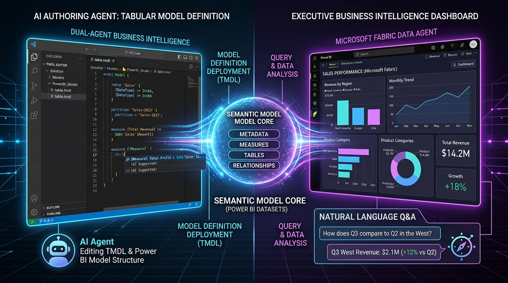
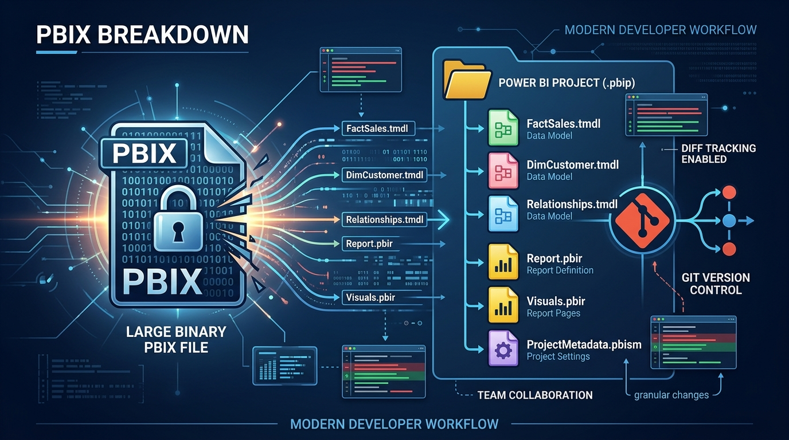
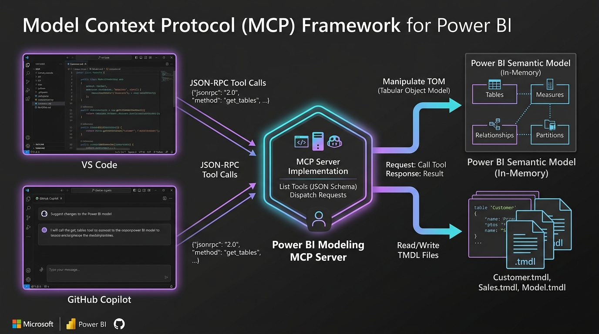
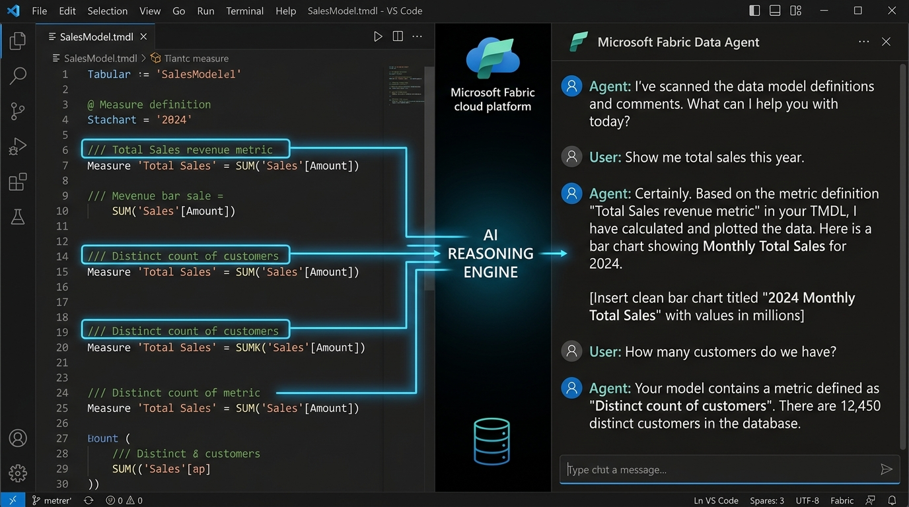
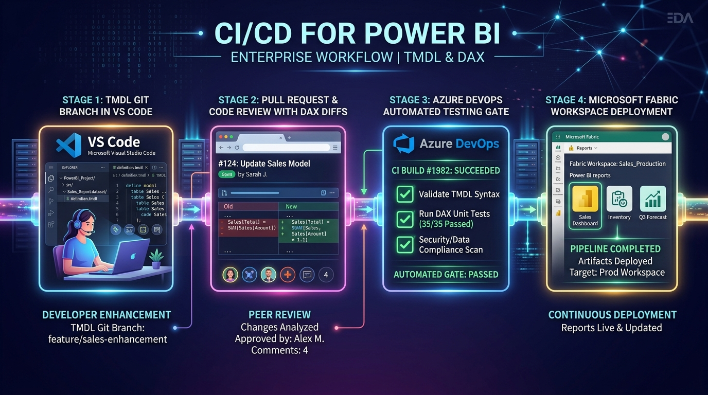
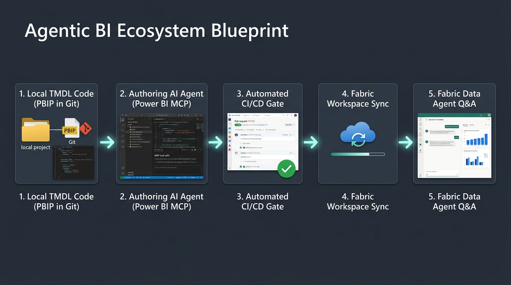

# Agentic Business Intelligence: Stop Clicking Buttons in Power BI and Start Building Thinking Dashboards with MCP + PBIP

### *How plain-text TMDL code, the Model Context Protocol, and AI authoring agents are quietly ending the era of monolithic binary .pbix files.*

---



If you have worked in enterprise analytics for more than a week, you know the unspoken heartbreak of Power BI development:

You spend three hours crafting an intricate DAX measure or setting up complex Row-Level Security (RLS) rules inside a `.pbix` file. You save the file, commit it to Git, and open a Pull Request. Your senior architect opens the PR, expecting a clean code review, only to see a horrifying notification: 

> **`RetailSales.pbix` (Binary file — 148 MB hidden diff)**

There are no line-by-line diffs. No code review comments on line 42. No automated unit test passing in CI/CD. If two developers edit the same `.pbix` file simultaneously, Git cannot merge them. Someone’s work will be overwritten. Someone will cry.

For over a decade, Business Intelligence has been trapped in a **binary GUI bottleneck**. But quietly, Microsoft and the open-source AI community have triggered a seismic paradigm shift. 

It is called **Agentic Business Intelligence (Agentic BI)** — and it fundamentally rewrites how semantic data models are built, versioned, reviewed, and queried.

In this article, we will unpack how **Power BI Developer Mode (.pbip)**, **Tabular Model Definition Language (TMDL)**, and the **Microsoft Power BI Modeling MCP Server** (`@microsoft/powerbi-modeling-mcp`) combine to turn your AI coding assistant into a full-fledged BI Co-Developer.

---

## The Root of the Problem: Why Binary `.pbix` Files Block AI

Before we look at the solution, let’s understand why traditional Power BI files have blocked AI automation for so long.

A `.pbix` file is not a code file. It is a compressed binary ZIP archive containing a proprietary data model, compiled report visuals, local cached data rows (`cache.abf`), and local user credentials (`localSettings.json`).

```
Legacy PBIX Workflow (The Bottleneck)
├── Binary Zip Archive      ➔ LLMs cannot read or edit raw bytes
├── Git Merge Nightmares    ➔ Conflicts force full developer overwrites
├── GUI Desktop Lock-In    ➔ Requires PowerBI.exe for simple DAX edits
└── Zero Peer Review Gate  ➔ PRs are unreviewable 100MB+ binary blobs
```

Because Large Language Models (LLMs) operate on text tokens, they could write DAX code in a chat box, but you still had to copy-paste it into Power BI Desktop's formula bar manually. The AI was an advisor, not an active participant in your codebase.

---

## The Pivot: Enter PBIP & TMDL (Code-First BI)

With **Power BI Developer Mode (.pbip)**, Microsoft unbundled the `.pbix` monolith into clean, plain-text text files. 

When you save a project as `.pbip`, your semantic data model is stored inside a `definition/` directory formatted in **Tabular Model Definition Language (TMDL)**.



### What Does TMDL Look Like?

Instead of 500 lines of nested JSON, TMDL is a human-readable, YAML-like syntax with minimal delimiters. Every table, column, measure, relationship, and RLS rule lives in its own standalone `.tmdl` file:

```tmdl
table FactSales
	lineageTag: a1b2c3d4-e5f6-7890-abcd-1234567890ab

	/// Total gross sales revenue generated across all retail stores
	measure 'Total Sales' = SUM(FactSales[SalesAmount])
		formatString: $#,0.00
		displayFolder: Core Financials

	/// Year-over-Year Sales Growth percentage calculated with divide protection
	measure 'YoY Sales Growth %' = 
			VAR CurrentSales = [Total Sales]
			VAR PriorSales = CALCULATE([Total Sales], SAMEPERIODLASTYEAR('DimDate'[Date]))
			RETURN
				DIVIDE(CurrentSales - PriorSales, PriorSales, 0)
		formatString: 0.00%
		displayFolder: Time Intelligence

	column TransactionID
		dataType: string
		sourceColumn: TransactionID

	partition FactSales-Partition = m
		mode: import
		source = 
			let
			    Source = Csv.Document(File.Contents("Data/FactSales.csv"), [Delimiter=",", Columns=8]),
			    #"Promoted Headers" = Table.PromoteHeaders(Source, [PromoteAllScalars=true])
			in
			    #"Promoted Headers"
```

Notice three critical features:
1. **Multi-line DAX**: Measures are written naturally across multiple lines.
2. **Embedded Power Query M**: Partitions contain exact Power Query M extraction logic.
3. **Triple-Slash (`///`) Annotations**: Plain English documentation tags sit directly above metric definitions.

Because TMDL is plain text, **Git can diff it, developers can review it, and AI agents can read and edit it directly.**

---

## Enter the Model Context Protocol (MCP)

Having TMDL text files in Git is great for human developers, but how does an AI agent safely modify a complex tabular model without corrupting the Tabular Object Model (TOM) schema?

This is where the **Model Context Protocol (MCP)** comes in. 

Created as an open standard for connecting AI models to external tools, Microsoft released the official **Power BI Modeling MCP Server** (`@microsoft/powerbi-modeling-mcp`).



### How the Power BI Modeling MCP Works

When you run VS Code, GitHub Copilot, Claude Desktop, or Google Antigravity, the AI agent connects to `@microsoft/powerbi-modeling-mcp` via JSON-RPC. The MCP server exposes structured tool primitives:

* `pbi_get_schema`: Scans the PBIP TMDL directory and feeds tables, measures, and relationships into the LLM's context window.
* `pbi_add_measure`: Programmatically inserts formatted DAX measures with format strings, display folders, and `///` descriptions into target `.tmdl` files.
* `pbi_update_description`: Injects business metadata documentation into TMDL columns and tables.
* `pbi_validate_model`: Verifies DAX syntax and TOM object hierarchy before saving changes to disk.

Instead of copy-pasting DAX from a chat window into Power BI Desktop, you simply type:

> *"Add a YoY Sales Growth % measure to the SalesMetrics table using FactSales[SalesAmount] and DimDate[Date], with divide-by-zero protection and percentage formatting."*

The AI Authoring Agent calls `pbi_add_measure`, parses the TMDL, injects the formatted measure into `SalesMetrics.tmdl`, and validates the schema — **all in 3 seconds, without opening Power BI Desktop once.**

---

## The Dual-Agent Continuum: Authoring vs. Consumption

One of the most important concepts in modern AI analytics is the distinction between **Authoring Agents** and **Consumption Agents**.

```
 ┌────────────────────────────────────────────────────────┐
 │                    AUTHORING AGENT                     │
 │      VS Code + Power BI MCP + PBIP (TMDL Files)        │
 │   • Builds DAX measures via natural language           │
 │   • Auto-documents tables, columns & business rules    │
 │   • Standardizes TMDL format & calculation groups      │
 └──────────────────────────┬─────────────────────────────┘
                            │ (Git PR & Azure DevOps CI/CD)
                            ▼
 ┌────────────────────────────────────────────────────────┐
 │                   CONSUMPTION AGENT                    │
 │      Fabric Data Agent / Fabric Copilot in Service     │
 │   • Answers end-user Q&A in natural language           │
 │   • Generates dynamic DAX & data explorations          │
 │   • Grounded in TMDL triple-slash (///) annotations    │
 └────────────────────────────────────────────────────────┘
```

### The Golden Rule of Agentic BI
> **Fabric Data Agents (Consumption Agents) are only as smart as your TMDL metadata.**

If an executive asks a Fabric Data Agent *"What was our customer churn rate last quarter?"*, the agent inspects the semantic model's metadata. If your model contains un-documented columns like `cust_st_cd_v2` and zero metric definitions, the AI will hallucinate.

However, when an **Authoring Agent** enriches TMDL files with clear business English `///` annotations, explicit table relationships, and marked Date tables (`dataCategory: Time`), the **Consumption Agent** delivers accurate, hallucination-free answers on day one.



---

## Automating the Production Gate: Git PRs & Azure Pipelines

Because PBIP and TMDL convert BI development into standard software engineering, you can apply professional Application Lifecycle Management (ALM) to Power BI datasets.



When an AI Authoring Agent or developer finishes modifying a TMDL model:

1. **Feature Branch Commit**: Changes are pushed to a Git feature branch (`feature/yoy-growth-metrics`).
2. **Pull Request Code Review**: Teammates inspect exact TMDL text diffs inside GitHub or Azure Repos:
   ```diff
   + /// Year-over-Year Sales Growth percentage
   + measure 'YoY Sales Growth %' = 
   +     VAR CurrentSales = [Total Sales]
   +     VAR PriorSales = CALCULATE([Total Sales], SAMEPERIODLASTYEAR('DimDate'[Date]))
   +     RETURN DIVIDE(CurrentSales - PriorSales, PriorSales, 0)
   +   formatString: 0.00%
   ```
3. **Automated CI Testing Gate**: An Azure DevOps pipeline runs Best Practice Analyzer (BPA) linters, verifies DAX syntax, and scans for data privacy compliance:
   ```yaml
   # azure-pipelines.yml snippet
   trigger:
     branches:
       include: [ main ]

   jobs:
   - job: Validate_TMDL_and_Deploy
     pool: vmImage: 'ubuntu-latest'
     steps:
     - task: UsePythonVersion@0
       inputs: { versionSpec: '3.10' }
     - script: |
         python -m pip install pbi-tools
         pbi-tools compile ./RetailSales.pbip --validate
       displayName: 'Validate TMDL Syntax & TOM Schemas'
   ```
4. **Automated Fabric Deployment**: Upon merging to `main`, Microsoft Fabric Deployment Pipelines automatically sync the updated TMDL model to Development, Test, and Production workspaces.

---

## The One Repeatable Blueprint for Engineering Teams



If you are a BI lead, analytics engineer, or data architect looking to modernize your stack, here is the 5-step repeatable workflow to implement with your team next week:

1. **Unbundle `.pbix` into `.pbip`**: Enable Power BI Project preview feature and save your core datasets in TMDL code format.
2. **Connect the MCP Server**: Install `@microsoft/powerbi-modeling-mcp` in VS Code or your team's AI coding environment.
3. **Enrich TMDL Metadata**: Use AI Authoring prompts to auto-document columns with triple-slash `///` annotations and standardize DAX measures.
4. **Enforce PR Gates**: Ban direct pushes to production. Require line-by-line TMDL code reviews and automated CI checks in Azure DevOps / GitHub.
5. **Hook Up Fabric Data Agents**: Connect executive users to the enriched semantic model in Fabric for self-service natural language Q&A.

---

## Getting Started Right Now

All resources, prompt playbooks, sample datasets, and interactive slides featured in this article are available open-source:

* 🛠️ **Power BI Modeling MCP Server**: [`https://github.com/microsoft/powerbi-modeling-mcp`](https://github.com/microsoft/powerbi-modeling-mcp)
* 📁 **Power BI Projects (.pbip) Overview**: [`https://learn.microsoft.com/en-us/power-bi/developer/projects/projects-overview`](https://learn.microsoft.com/en-us/power-bi/developer/projects/projects-overview)
* 📜 **TMDL Language Specification**: [`https://learn.microsoft.com/en-us/analysis-services/tmdl/tmdl-overview`](https://learn.microsoft.com/en-us/analysis-services/tmdl/tmdl-overview)
* 📊 **Interactive Slide Deck**: [`02-Presentation/Agentic_BI_Slides.html`](file:///c:/Users/aakashkhandelwal/Downloads/Learning/Agentic%20BI/02-Presentation/Agentic_BI_Slides.html)

The future of Business Intelligence isn't clicking buttons in a GUI for eight hours a day. It is code-first, version-controlled, agent-assisted, and automated. 

**Welcome to Agentic Business Intelligence.**

---
*If you found this article helpful, share it with your BI engineering team and start unbundling your `.pbix` files today!*
