# Power BI & Microsoft Fabric CI/CD & Deployment Pipelines Architecture Guide

## Executive Summary

As organizations transition from monolithic `.pbix` binary files to **Power BI Project (.pbip)** plain-text files in Git, a fundamental question arises:

> **How does CI/CD work for Power BI and Microsoft Fabric? Is deployment done for individual Reports, Semantic Models, the entire Workspace, or all Fabric artifacts? And how do Git CI/CD pipelines work alongside Microsoft Fabric Deployment Pipelines?**

This architecture guide provides a comprehensive breakdown of the **Dual-Engine Deployment Pattern** (Git CI/CD + Fabric Deployment Pipelines), detailing item granularities, deployment rules, and multi-workspace promotion strategies.

---

## 1. What Gets Deployed? Granularity Breakdown

In legacy Power BI (`.pbix`), the report visuals and semantic model data model were tightly coupled inside a single file. With **PBIP Developer Mode**, Microsoft strictly separates these artifacts:

```
RetailSales.pbip (Root Project Pointer)
├── RetailSales.Report/                  ➔ REPORT ARTIFACT (Visuals & Layout)
│   ├── definition.pbir                  ➔ Links report to semantic model
│   ├── definition/report.json           ➔ Visual pages, charts, theme specs
│   └── item.config.json                 ➔ Fabric GUID identity
└── RetailSales.Dataset/                 ➔ SEMANTIC MODEL ARTIFACT (Data Model)
    ├── definition.pbism                 ➔ Semantic model pointer
    ├── model.bim                        ➔ TMSL JSON schema
    ├── definition/relationships.tmdl    ➔ Star schema relationships
    └── definition/tables/*.tmdl         ➔ TMDL tables, DAX measures & M partitions
```

### Granularity Levels:

1. **Item / Artifact Level (Report vs. Dataset)**:
   - You can deploy or update **just the Report** (`.Report/`) without touching the underlying Semantic Model.
   - You can deploy or update **just the Semantic Model** (`.Dataset/`) without re-publishing report visuals.
2. **Workspace Level**:
   - Fabric Git integration connects a Git branch (`main`) directly to a target **Microsoft Fabric Workspace**. All artifacts present in the repository sync as live workspace items.
3. **Whole Fabric Ecosystem Artifacts**:
   - CI/CD and deployment pipelines are **NOT restricted to Power BI**. They support the entire Microsoft Fabric artifact suite:
     - 📊 **Power BI Reports & Paginated Reports (.rdl)**
     - 🧠 **Power BI Semantic Models (.Dataset / TMDL)**
     - 🔄 **Dataflows Gen2**
     - 🚀 **Fabric Data Pipelines**
     - 📓 **Fabric Notebooks (PySpark / Scala / SQL)**
     - 🏊 **Fabric Lakehouses & Warehouses (SQL Schemas & Metadata)**
     - ⚙️ **Fabric Environments & KQL Databases**

---

## 2. The Dual-Engine Pattern: Git CI/CD vs. Fabric Deployment Pipelines

Enterprise organizations leverage **two complementary deployment engines**:

```
 ┌───────────────────────────────────────────────────────────────────────────────────┐
 │                        ENGINE 1: GIT & AZURE DEVOPS CI/CD                         │
 │                   (Developer Source Control & Code Quality Gate)                  │
 │                                                                                   │
 │   Dev Branch ➔ Pull Request ➔ Automated Linters/Tests ➔ Merge ➔ Dev Workspace     │
 └─────────────────────────────────────────┬─────────────────────────────────────────┘
                                           │
                                           ▼
 ┌───────────────────────────────────────────────────────────────────────────────────┐
 │                   ENGINE 2: FABRIC DEPLOYMENT PIPELINES                           │
 │                (Environment Stage Promotion & Rule Overrides)                     │
 │                                                                                   │
 │   Dev Workspace  ──────(Promote)─────►  Test Workspace  ──────(Promote)─────► Prod │
 │   (Dev Connections)                 (Test Connections)                 (Prod Conn)│
 └───────────────────────────────────────────────────────────────────────────────────┘
```

---

### Engine 1: Git Integration & Azure DevOps CI/CD (Source Control & Code Quality)

**Purpose**: Governs developer collaboration, feature branching, TMDL syntax validation, Best Practice Analyzer (BPA) checks, and automated merging into the **Development Workspace**.

#### How it works:
1. Developers work locally in VS Code using plain-text TMDL files or in Power BI Desktop.
2. Changes are committed to a Git feature branch (`feature/sales-metrics`).
3. A **Pull Request (PR)** triggers an automated Azure DevOps or GitHub Actions pipeline (`azure-pipelines.yml`).
4. The CI pipeline executes automated tests:
   - **TMDL Syntax Validation**: Verifies TOM schema compilation via `pbi-tools` or Tabular Editor CLI.
   - **Best Practice Analyzer (BPA)**: Checks for un-indexed columns, un-formatted DAX, or missing `///` documentation annotations.
   - **Security Scan**: Ensures `.cache/` and local credential secrets are excluded via `.gitignore`.
5. Upon PR approval, code merges to the `main` branch.
6. Microsoft Fabric Git Integration automatically syncs the `main` branch with the **Development Fabric Workspace**.

---

### Engine 2: Microsoft Fabric Deployment Pipelines (Stage Promotion & Environment Rules)

**Purpose**: Promotes deployed workspace artifacts across isolated environment stages (**Development ➔ Test ➔ Production**) while applying **Deployment Rules** for connection strings and parameters.

#### How it works:
1. Once artifacts sit cleanly in the **Development Workspace**, developers open **Fabric Deployment Pipelines**.
2. **Stage Promotion**: Click **Deploy to Test** or **Deploy to Production**.
3. **Deployment Rules (Environment Overrides)**:
   - *Problem*: Your Dev dataset connects to `dev-sql.database.windows.net`, but Prod must connect to `prod-sql.database.windows.net`.
   - *Solution*: Fabric Deployment Pipelines apply **Parameter & Data Source Rules** automatically during stage promotion without modifying the TMDL code!

| Environment Stage | Target Workspace | Data Source Connection Rule | Parameters Override | Access Permission |
| :--- | :--- | :--- | :--- | :--- |
| **Development** | `Sales_Workspace_Dev` | `dev-sqlserver.database.windows.net` | `MaxRows = 1000` | Developers & AI Agents |
| **Testing (QA)** | `Sales_Workspace_Test` | `test-sqlserver.database.windows.net` | `MaxRows = 100000` | QA Testers & Business Leads |
| **Production** | `Sales_Workspace_Prod` | `prod-sqlserver.database.windows.net` | `MaxRows = Unlimited` | End-User Business Reports & Fabric Data Agents |

---

## 3. End-to-End Architecture Workflow Diagram

```mermaid
flowchart LR
    subgraph LocalDev ["Local Developer / AI Agent"]
        A["VS Code + Power BI MCP"] --> B["PBIP / TMDL Code Files"]
    end

    subgraph GitCI ["Git & Azure DevOps CI/CD (Engine 1)"]
        B -->|Git Push| C["Feature Branch"]
        C -->|Pull Request| D["Azure DevOps Pipeline"]
        D -->|1. Validate TMDL Syntax\n2. Run BPA Linters\n3. DAX Unit Tests| E{"PR Gate Passed?"}
        E -->|Yes| F["Merge to main branch"]
        E -->|No| C
    end

    subgraph FabricSync ["Fabric Dev Sync"]
        F -->|Fabric Git Sync| G["Dev Workspace"]
    end

    subgraph FabricPipe ["Fabric Deployment Pipelines (Engine 2)"]
        G -->|Deploy to Test| H["Test Workspace\n(Apply QA Rules)"]
        H -->|Deploy to Prod| I["Production Workspace\n(Apply Prod Connection Rules)"]
    end

    subgraph Consumption ["Executive Consumption"]
        I --> J["Power BI Reports & Fabric Data Agents"]
    end
```



---

## 4. Key Questions Answered

### Q1: Is CI/CD performed for the Report, Dataset, Workspace, or Whole Artifact?
- **Answer**: It happens at **all levels**:
  - **Git Level**: Code diffs occur per file (`FactSales.tmdl`, `report.json`).
  - **Artifact Level**: Fabric tracks individual Report GUIDs and Dataset GUIDs inside `item.config.json`. You can update a report without touching the dataset, or update a dataset without redeploying reports.
  - **Workspace Level**: The Fabric workspace acts as the live deployment container receiving Git branch syncs.

### Q2: Is CI/CD only for Power BI or the Whole Fabric Ecosystem?
- **Answer**: It covers the **entire Microsoft Fabric ecosystem**. Fabric Git integration and deployment pipelines natively version and deploy Lakehouses, Warehouses, Notebooks, Dataflows Gen2, Data Pipelines, and Power BI items in a unified pipeline.

### Q3: How do we prevent credentials or local cache from leaking to Git?
- **Answer**: Every PBIP project must include a standardized `.gitignore`:
  ```gitignore
  # Power BI Project local settings & Analysis Services cache
  .cache/
  .pbi/
  cache.abf
  localSettings.json
  *.user
  ```

---

## 5. Summary Blueprint Checklist for BI Engineering Leads

1. **Adopt PBIP + TMDL**: Convert binary `.pbix` models into version-controlled `.pbip` repositories.
2. **Set Up Azure DevOps CI/CD**: Implement automated TMDL syntax validation (`azure-pipelines.yml`) on Pull Requests.
3. **Connect Dev Workspace to Git**: Sync the `main` branch with your Fabric Development workspace.
4. **Configure Fabric Deployment Pipelines**: Define **Dev ➔ Test ➔ Production** pipeline stages with automated Parameter & Connection Data Source rules.
5. **Enable Fabric Data Agents**: Connect executive users to the production workspace for natural language querying over enriched TMDL metadata.
