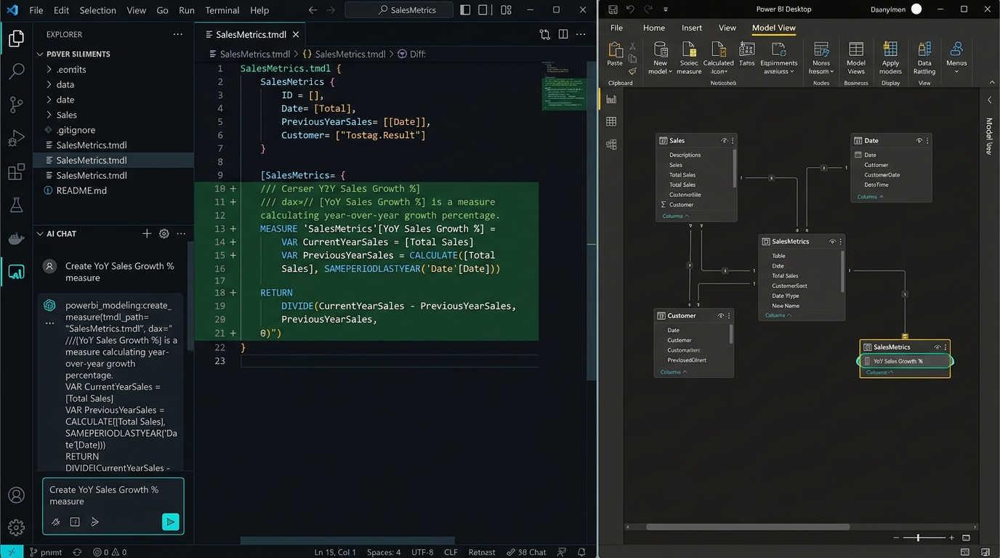

# 🤖 Agentic Business Intelligence (Agentic BI)
### *Build a Thinking Dashboard with Power BI MCP + PBIP & Microsoft Fabric*

[](https://learn.microsoft.com/en-us/power-bi/developer/projects/projects-overview)
[](https://learn.microsoft.com/en-us/analysis-services/tmdl/tmdl-overview)
[](https://github.com/microsoft/powerbi-modeling-mcp)
[](https://learn.microsoft.com/en-us/fabric/cicd/git-integration/intro-to-git-integration)
[](#)

---

## 🌟 Executive Overview

Welcome to the definitive repository for **Agentic Business Intelligence (Agentic BI)**. This repository houses the complete deliverables, architectures, live projects, prompt playbooks, and interactive presentation materials from our 90-minute workshop:

> **"Agentic Business Intelligence — Build a Thinking Dashboard with Power BI MCP + PBIP"**

Historically, Business Intelligence has been trapped in **opaque, binary desktop files (`.pbix`)** and slow, manual **"click-ops"**. This repository demonstrates how the convergence of **Code-First Power BI Projects (`.pbip` / TMDL)** and the **Model Context Protocol (MCP)** transforms BI development from manual drag-and-drop into an automated, AI-augmented, enterprise-grade engineering discipline.

---

## 🎯 The Paradigm Shift: From Click-Ops to Agentic BI

```
┌────────────────────────────────────────┐       ┌────────────────────────────────────────┐
│         TRADITIONAL BI (PBIX)          │       │          AGENTIC BI (PBIP + MCP)       │
├────────────────────────────────────────┤       ├────────────────────────────────────────┤
│ • Binary, unreadable .pbix blobs       │  ───► │ • Human-readable TMDL & PBIR folders   │
│ • "Binary file differs" Git commits    │       │ • Granular, reviewable line-by-line PRs│
│ • Click-ops measure authoring in GUI   │       │ • Autonomous DAX creation via MCP tools│
│ • Manual documentation & stale wikis   │       │ • Self-documenting models (/// TMDL)   │
│ • Prone to downstream AI hallucinations│       │ • Zero-hallucination Fabric Data Agents│
└────────────────────────────────────────┘       └────────────────────────────────────────┘
```

---

## 🧠 Core Architecture: The Dual-Agent Continuum

The core innovation of Agentic BI is the **Dual-Agent Continuum** — bridging model creation and model consumption through a shared, plain-text semantic contract:

```
┌─────────────────────────────────────────────────────────────────────────────┐
│                             1. THE AUTHORING AGENT                          │
│                   (VS Code / AI Coding Assistant + Power BI MCP)            │
│                                                                             │
│  • Reads live semantic model schema via Model Context Protocol tools        │
│  • Programmatically authors DAX measures, calculation groups, and hierarchies│
│  • Injects rich semantic metadata: triple-slash (///) descriptions & tags    │
└──────────────────────────────────────┬──────────────────────────────────────┘
                                       │
                                       ▼ Git Pull Request & Branch Gate
┌─────────────────────────────────────────────────────────────────────────────┐
│                       2. CI/CD AUTOMATED GATEWAY                            │
│                 (Azure DevOps / GitHub Actions + Fabric Git)                 │
│                                                                             │
│  • Validates TMDL syntax, Best Practice Analyzer (BPA) rules & DAX safety   │
│  • Deploys `.Dataset` (Semantic Model) and `.Report` (Visuals) separately    │
│  • Promotes across Dev ➔ Test ➔ Prod using Fabric Deployment Pipelines      │
└──────────────────────────────────────┬──────────────────────────────────────┘
                                       │
                                       ▼ Fabric Service Sync
┌─────────────────────────────────────────────────────────────────────────────┐
│                           3. THE CONSUMPTION AGENT                          │
│                 (Fabric Data Agent / Copilot in Fabric Service)             │
│                                                                             │
│  • Answers ad-hoc executive and business questions in natural language      │
│  • Dynamically writes and runs DAX queries against the deployed model       │
│  • Zero-hallucination: Directly grounded in Authoring Agent's TMDL metadata  │
└─────────────────────────────────────────────────────────────────────────────┘
```

---

## 🎥 Live Demo Screencast: Headless MCP Modeling in Action

Here is what happens during a live Agentic BI session: The developer prompts the AI Co-Developer in VS Code, the AI executes the `powerbi_modeling:create_measure` MCP tool call, the TMDL file mutates with a clean Git diff, and Power BI Desktop updates its model in real time without touching the GUI:



> 🎮 **Interactive Screencast Player**: Open [`02-Presentation/demo-screencast.html`](02-Presentation/demo-screencast.html) in any browser to watch the animated, step-by-step screencast with live play/pause, scrub controls, and synchronized code diffs!

---

## 🗺️ The End-to-End Process Walkthrough

Anyone exploring this repository can follow the complete end-to-end lifecycle executed during the workshop:

### 1. Local Environment Setup & Discovery
- **Power BI Desktop (August 2026+)**: Configured with PBIP enhanced metadata and developer preview mode enabled.
- **Power BI Modeling MCP Plugin**: Connected directly into the LLM environment (or via `mcp-server-config.json`) exposing headless Tabular Object Model (TOM) tools.

### 2. Code-First Modeling with MCP Tools
- Instead of clicking "New Measure" in Power BI Desktop, the developer commands the AI agent using natural language.
- The MCP server executes atomic, read/write actions against the running Tabular instance or TMDL files (`list_tables`, `get_table_schema`, `create_measure`, `update_measure`).
- **Prompt Safety**: Following the [4 Golden Rules](05-Prompts-and-Workflows/MCP-Prompting-Best-Practices.md) prevents recursive loops and long-running hangs.

### 3. Rich Semantic Annotation for Downstream AI
- Measures and columns are decorated with TMDL `///` descriptions, format strings, and display folders.
- These annotations form the semantic boundary that ensures downstream Copilots and Fabric Data Agents calculate metrics consistently.

### 4. Git Versioning & Granular Peer Review
- Changes are committed to Git as plain text.
- Reviewers inspect clean visual diffs in Pull Requests (e.g. `+ measure 'YoY Growth %' = ...`), eliminating binary merge conflicts forever.

### 5. Automated CI/CD & Fabric Deployment Pipelines
- Automated pipelines validate DAX formatting and security rules.
- Workspace Git integration syncs changes to the Fabric Development workspace.
- Fabric Deployment Pipelines govern controlled promotion to Test and Production with dataset parameter rules.

---

## 📂 Repository Roadmap & Deliverables

Every folder in this repository corresponds to a distinct phase of the workshop:

```
Agentic BI/
├── README.md                                                 # Master Showcase & Process Guide (This file)
├── 01-Session-Plan/                                          # Workshop Facilitation & Timeline
│   ├── 90-Min-Agenda.md                                      # 5-module minute-by-minute timeline
│   └── Facilitator-Guide.md                                  # Speaker script, setup checklists, transition cues
│
├── 02-Presentation/                                          # Architecture, Visuals & Presentation
│   ├── Agentic_BI_Slides.html                                # Interactive 18-slide deck (Light/Dark mode + Lightbox)
│   ├── demo-screencast.html                                  # Interactive animated screencast demo player
│   ├── Medium-Blog-Post.md                                   # Comprehensive Medium-ready technical publication
│   ├── PowerBI-CI-CD-and-Deployment-Pipelines-Architecture.md# Deep dive on CI/CD & Fabric deployment pipelines
│   ├── PBIX-to-PBIP-Mapping-Guide.md                          # Visual Rosetta Stone: Desktop GUI ➔ TMDL folder
│   ├── Slide-Deck-Outline.md                                 # Full 18-slide deck structure & speaker notes
│   ├── Key-Concepts.md                                        # Technical reference on TMDL, PBIR, and schemas
│   └── images/                                                # 11 production-quality visual assets
│       ├── mcp_live_demo_screencast.jpg                      # Live demo screencast: VS Code MCP + Power BI Desktop
│       ├── dual_agent_continuum.jpg                          # Hero visual: Authoring vs Consumption Agent
│       ├── git_pbix_vs_pbip_diff.jpg                          # Git diff comparison: PBIX blob vs TMDL text
│       ├── pbip_folder_deep_dive.jpg                          # PBIP anatomy (.Report vs .Dataset)
│       ├── pbix_to_pbip_folder.jpg                            # PBIX exploding into modular TMDL text files
│       ├── mcp_architecture.jpg                               # Power BI Modeling MCP framework
│       ├── mcp_protocol_anatomy.jpg                           # Model Context Protocol message flow
│       ├── mcp_vs_standard_prompts.jpg                        # Headless tool execution vs generic LLM chat
│       ├── fabric_agent_tmdl.jpg                              # Fabric Data Agent grounded in TMDL metadata
│       ├── cicd_pipeline_gate.jpg                             # Azure DevOps pull request quality gate
│       └── ecosystem_blueprint.jpg                            # 5-step enterprise lifecycle blueprint
│
├── 03-Demo-Project/                                          # Live Power BI Project (PBIP)
│   ├── README.md                                             # Demo project quickstart & architecture guide
│   ├── RetailSales.pbip                                      # Validated root PBIP pointer file
│   ├── generate_data.py                                       # Synthetic generator script (2023–2026 data)
│   ├── Data/                                                 # 4 CSV data sources (5,000 transactions)
│   │   ├── FactSales.csv, DimCustomer.csv, DimProduct.csv, DimDate.csv
│   │
│   ├── RetailSales.Report/                                   # Modern PBIR report visual definition
│   │   ├── definition.pbir, definition/report.json, item.config.json
│   │
│   └── RetailSales.Dataset/                                  # Semantic model folder (TMDL format)
│       ├── definition.pbism, model.bim
│       └── definition/
│           ├── model.tmdl                                     # Model properties
│           ├── relationships.tmdl                             # Star-schema relationship bindings
│           └── tables/                                        # Modular table definitions & measures
│               ├── FactSales.tmdl, DimCustomer.tmdl, DimProduct.tmdl, DimDate.tmdl, SalesMetrics.tmdl
│
├── 04-MCP-Setup/                                             # MCP Configuration & Simulation
│   ├── mcp-config-guide.md                                   # Step-by-step Plugin installation & setup guide
│   ├── mcp-server-config.json                                 # Production JSON config snippet
│   └── mock-mcp-simulator.py                                  # Standalone Python simulator for offline testing
│
└── 05-Prompts-and-Workflows/                                 # Prompt Engineering & CI/CD Playbooks
    ├── MCP-Prompting-Best-Practices.md                        # 4 Golden Rules & how to avoid 10-minute hangs
    ├── DAX-Generation-Playbook.md                             # Tested prompts for base, YTD, and YoY DAX
    ├── Documentation-Playbook.md                              # Automated TMDL triple-slash documentation
    ├── Fabric-Data-Agent-Bridge.md                            # Checklist to prep semantic models for agents
    ├── Cross-Model-Copy-Playbook.md                           # Headless measure & calc group migration
    └── PR-Review-Gate.md                                      # Pull request checklist & Azure Pipelines YAML
```

---

## ⚡ Quickstart: Experience the Workshop in 5 Minutes

### Step 1: Open the Interactive Slide Deck
Double-click [`02-Presentation/Agentic_BI_Slides.html`](02-Presentation/Agentic_BI_Slides.html) in any modern browser.
* Toggle between **Light** and **Dark** themes.
* Click any diagram to open the **full-screen high-res lightbox**.
* Test the interactive **TMDL Viewer**, **Readiness Calculator**, and **Prompt Simulator**.

### Step 2: Open the Live Demo Project
1. Launch **Power BI Desktop** (August 2026 release or later).
2. Open [`03-Demo-Project/RetailSales.pbip`](03-Demo-Project/RetailSales.pbip).
3. Click **Home ➔ Refresh** to load data from the local CSVs.
4. Open the project folder in **VS Code** to inspect the TMDL files directly under `RetailSales.Dataset/definition/tables/`.

### Step 3: Run the Standalone MCP Simulator (No PBI Desktop Required)
If you don't have Power BI Desktop running, test how an AI agent uses MCP tools via the included Python simulator:
```powershell
python 04-MCP-Setup/mock-mcp-simulator.py
```
This script validates table listing, schema inspection, measure creation, and TMDL generation headlessly.

### Step 4: Follow the MCP Prompting Playbook
When using Copilot, Claude, or Antigravity with the Power BI Modeling MCP Server:
1. Review [`05-Prompts-and-Workflows/MCP-Prompting-Best-Practices.md`](05-Prompts-and-Workflows/MCP-Prompting-Best-Practices.md).
2. Follow **Golden Rule #1**: Always run a **Schema Inspection** before requesting changes.
3. Follow **Golden Rule #2**: Request **one measure at a time** to prevent multi-call background hangs.

---

## 💡 Key Architectural Takeaways

### 1. Plugin vs Extension: Why Install as an MCP Plugin?
- **VS Code Extension**: Designed primarily for human interactive UI inside the editor (sidebars, syntax highlighting, local commands).
- **MCP Plugin**: Connects the Model Context Protocol directly into the LLM's tool execution runtime. This allows the AI agent to reason over model objects, call Tabular APIs autonomously, and self-correct syntax errors without requiring manual UI clicking.

### 2. Dual-Engine CI/CD: Artifacts vs Workspaces
- **Git CI/CD** operates at the **file/artifact level**: `.Dataset/` and `.Report/` have separate life cycles. A data engineer can modify DAX without touching visuals, and a report designer can update charts without touching the dataset.
- **Fabric Deployment Pipelines** operate at the **workspace level**: They promote entire synchronized environments from Dev ➔ Test ➔ Prod, applying automated parameter rules (e.g., pointing Dev to test SQL servers and Prod to production Lakehouses).

### 3. Eliminating AI Hallucination with TMDL Annotations
Generative AI consumption agents (like Fabric Data Agents) fail when semantic models have ambiguous column names or undocumented calculations. By enforcing triple-slash (`///`) annotations in TMDL during authoring, the AI is supplied with strict business definitions, synonym mappings, and data formats directly within the semantic model.

---

## 📚 References & Official Resources

- [Power BI Modeling MCP Server Repository](https://github.com/microsoft/powerbi-modeling-mcp)
- [Power BI Projects (.pbip) Documentation](https://learn.microsoft.com/en-us/power-bi/developer/projects/projects-overview)
- [Tabular Model Definition Language (TMDL) Reference](https://learn.microsoft.com/en-us/analysis-services/tmdl/tmdl-overview)
- [Microsoft Fabric Git Integration & CI/CD Guide](https://learn.microsoft.com/en-us/fabric/cicd/git-integration/intro-to-git-integration)
- [Fabric Data Agents & Copilot in Power BI](https://learn.microsoft.com/en-us/fabric/get-started/copilot-fabric-overview)

---
*Created for the Agentic Business Intelligence Workshop Series. Built with Power BI Desktop, TMDL, Model Context Protocol, and Microsoft Fabric.*
